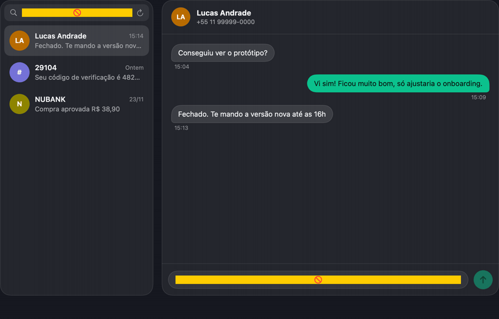
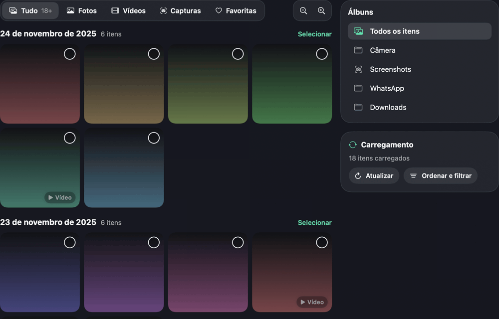
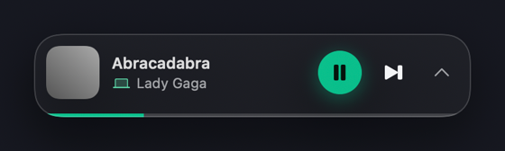
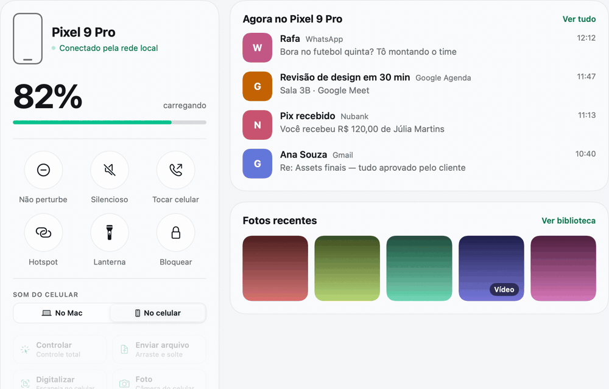

<p align="center">
  
</p>

<h1 align="center">masterSync</h1>

<p align="center"><b>Seu Android dentro do Mac.</b><br>
Notificações, SMS, fotos, arquivos, área de transferência e controle do celular, pela rede local e sem nuvem.</p>

<p align="center">
  
</p>

> As imagens e GIFs deste README são telas do app renderizadas com **dados de exemplo** (nomes, mensagens e fotos fictícios). Nada aqui vem de um aparelho real.

## O que é

O masterSync liga um celular Android a um Mac por uma conexão criptografada na **mesma rede Wi‑Fi**. Nada passa por servidor de terceiros: o Mac e o celular conversam direto.

- **Mac:** app nativo em SwiftUI e AppKit (macOS 14 ou mais novo).
- **Android:** app nativo em Kotlin, Jetpack Compose e Material 3 (Android 10 ou mais novo).
- **Visual alinhado nos dois lados:** acento verde‑água, tema claro e escuro (no Mac, com janela de vidro).

## O que dá para fazer

### Visão geral do celular

Bateria, estado da conexão e seis botões que funcionam de verdade: **Não perturbe, Silencioso, Tocar celular, Hotspot, Lanterna e Bloquear**. Ao lado, as **notificações de agora** e as **últimas fotos** do celular. Também escolhe se o som do celular sai **no Mac ou no celular**.

<p align="center"></p>

### SMS no Mac

Leia, receba e responda os SMS do celular pelo Mac, com nome dos contatos, busca, contador de não lidas e mensagens novas na hora. Só SMS: o RCS do Google Mensagens não é compartilhado pelo Android. Vem desligado e só funciona na versão completa do app, depois que você permite o acesso.

<p align="center"></p>

### Fotos

A galeria do celular no Mac, com abas (Tudo, Fotos, Vídeos, Capturas, Favoritas), grade por dia, seleção em lote, álbuns e um visualizador com setas do teclado. Atualiza sozinha quando você tira fotos novas.

<p align="center"></p>

### Arquivos e armazenamento interno

Arraste arquivos ou pastas (pastas viram `.zip`) para o celular, acompanhe cada transferência e **navegue pelas pastas do armazenamento interno** do celular para baixar o que quiser. Mostra o espaço livre, onde cada coisa é salva e opções como **Abrir ao receber**.

<p align="center"></p>

<p align="center"></p>

### Controle do celular no próprio app

Veja e use a tela do Android numa janelinha do app, com mouse, rolagem e teclado, **sem aparecer pedido de autorização no celular** e sem cair quando ele bloqueia. Funciona por ADB sem fio e pelo servidor do [scrcpy](https://github.com/Genymobile/scrcpy).

Na tela **Apps**, fixe apps do celular: cada um vira um **app do Mac** (Launchpad e Spotlight) que abre numa janela própria.

<p align="center"></p>

### Notificações, códigos e área de transferência

- **Notificações** do celular no Mac, com resposta, dispensar e limpar tudo (some no celular também).
- **Códigos de verificação (2FA):** quando chega um código, o Mac copia o número e avisa num pop‑up no canto da tela. O código não vai para o histórico, some da área de transferência em 2 minutos e funciona até com o celular bloqueado.
- **Área de transferência** compartilhada, com texto e imagens, inclusive com outros teclados (por USB ou Wi‑Fi com ADB).

### Digitalizar

Aperte o atalho (personalizável) ou o botão **Digitalizar**: o celular abre a câmera de documentos, e a página chega ao Mac com um **pop‑up de progresso**. Cada digitalização abre uma janela com **Salvar, Copiar, Enviar na conversa e Excluir**.

### Player de mídia

O que está tocando no celular (Spotify, YouTube e outros), com capa, barra de posição, fila e a escolha de onde o som sai.

<p align="center">
  
  &nbsp;&nbsp;
  
</p>

### Tema claro e escuro

<p align="center"></p>

## Como começar

1. **Mac:** abra o `Nexus masterSync.app`, vá em **Dispositivos → Ativar rede local → Gerar QR**.
2. **Android:** abra o app, vá em **Dispositivos → Ler QR** e confira o nome do Mac.
3. No Mac, confira o nome e o modelo do celular e toque em **Autorizar**.
4. Ligue o que quiser usar nos dois lados. Cada recurso tem o próprio interruptor e pede só as permissões de que precisa.

Para controle do celular, apps fixados, armazenamento interno e botões como Bloquear, configure o **controle por Wi‑Fi (ADB)** na tela Dispositivos. É preciso ter o `adb` e, para o controle na janelinha, o `scrcpy` instalados no Mac:

```bash
brew install android-platform-tools scrcpy
```

O passo a passo completo (USB, Wi‑Fi, pareamento) está no [guia de uso](docs/GUIA-DE-USO.md).

## Privacidade e segurança

- **Tudo local.** Sem conta, sem nuvem, sem servidor. A conexão fica na sua rede.
- **Pareamento por QR com certificado fixado:** a identidade do outro aparelho é verificada pela impressão digital do certificado, não pelo endereço IP.
- **Cada recurso é opt‑in** e pode ser desligado a qualquer hora, nos dois lados.
- **SMS** não são gravados em disco no Mac; vivem só na memória enquanto o app está aberto.
- **Códigos 2FA** não entram no histórico da área de transferência e saem dela sozinhos. Com a opção "ocultar conteúdo" ligada, o código não é enviado.
- **Notificações marcadas como secretas** pelos apps não são espelhadas.

Detalhes em [permissões e distribuição](docs/PERMISSOES-E-DISTRIBUICAO.md) e no [protocolo](docs/PROTOCOLO.md).

## Duas edições do app Android

| | Completa | Direta |
|---|---|---|
| Arquivos, galeria, área de transferência, digitalização | sim | sim |
| Notificações, SMS, lanterna e silencioso, códigos 2FA | sim | não |
| Pensada para | uso próprio e testes | instalação sem permissões sensíveis |

## Limitações conhecidas

- **RCS** (Google Mensagens) não aparece: o Android não o expõe a outros apps.
- **Hotspot:** o Android recente não deixa ligar o hotspot de fora; o botão abre a tela de hotspot do celular.
- **Armazenamento interno** vem do ADB: a pasta `Android/data` é bloqueada pelo próprio Android.
- Remetentes com nome (como "NUBANK") podem ser lidos, mas não respondidos por SMS.
- O app do Mac usa assinatura local; a notarização faz parte do fluxo de publicação.

## Compilar e testar

```bash
# Mac (macOS 14+, Swift 5.9+)
./scripts/build-macos.sh              # gera o ZIP em dist/
swift test --package-path macOS

# Android (JDK 17 ou 21, SDK Platform 36)
cd android
./gradlew :app:assembleFullDebug :app:assembleDirectDebug
./gradlew :app:testFullDebugUnitTest :app:testDirectDebugUnitTest
```

As imagens e GIFs deste README são gerados pelos próprios testes de tela:

```bash
NEXUS_RENDER_SCALE=2 swift test --package-path macOS --filter "ShellRenderTests|MiniPlayerRenderTests"
scripts/make-readme-media.sh          # precisa do ffmpeg; saída em docs/media/
```

## Estrutura

```
macOS/                 app do Mac (SwiftUI/AppKit) e testes
  Sources/NexusCore/     mensagens, conexão TLS, servidor Bonjour
  Sources/NexusMasterSync/  telas, integrações com o macOS, ADB e scrcpy
android/               app Android (Kotlin/Compose), edições completa e direta
docs/                  arquitetura, protocolo, design, guia de uso
scripts/               build do Mac e geração das mídias do README
```

## Documentação

- [Guia de uso e instalação](docs/GUIA-DE-USO.md)
- [Arquitetura](docs/ARQUITETURA.md)
- [Protocolo](docs/PROTOCOLO.md)
- [Permissões e distribuição](docs/PERMISSOES-E-DISTRIBUICAO.md)
- [Design](docs/DESIGN.md)
