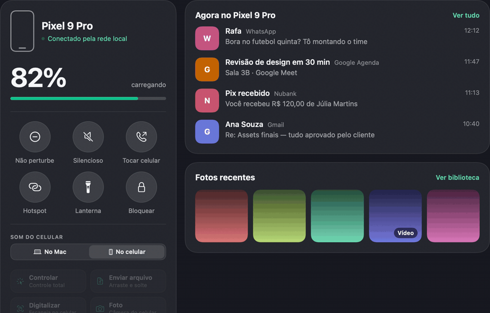
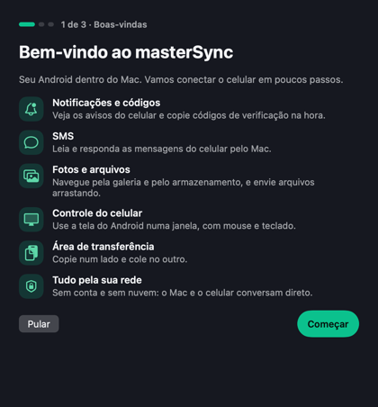
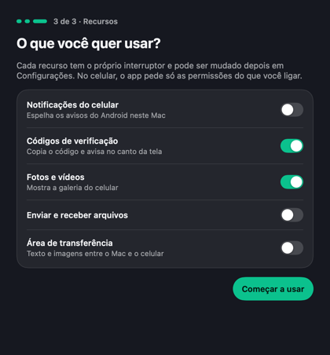
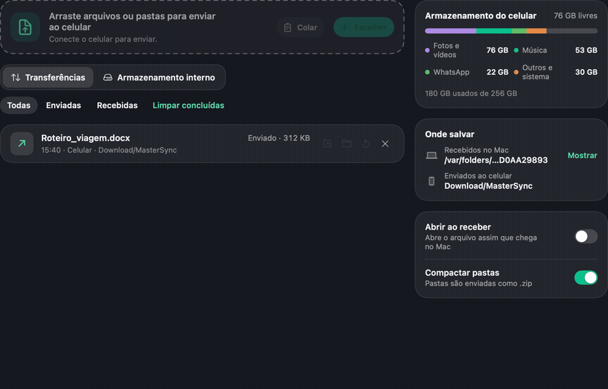
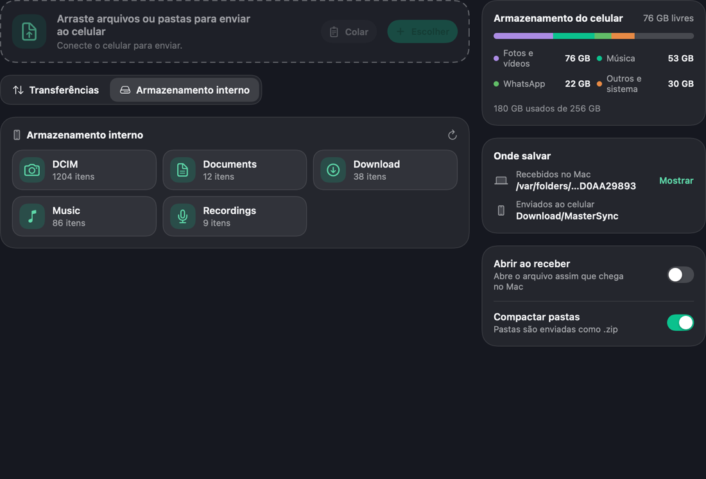
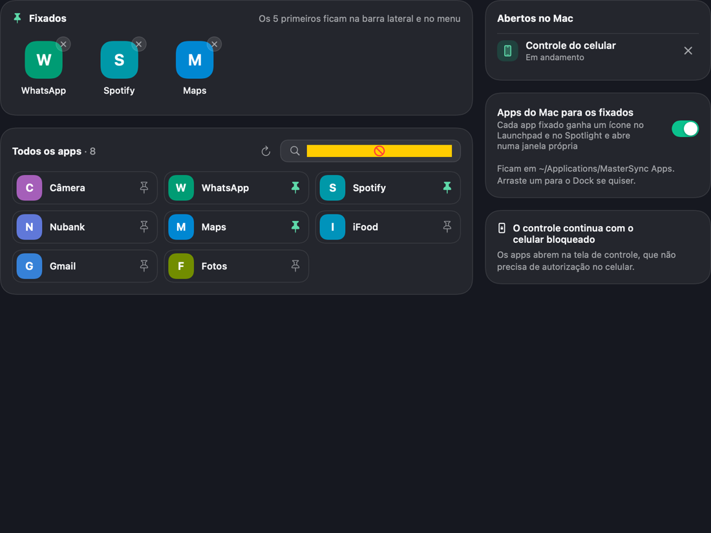
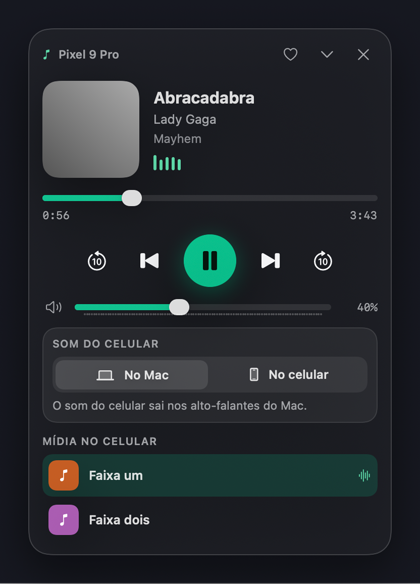

<p align="center">
  
</p>

<h1 align="center">masterSync</h1>

<p align="center"><b>Seu Android dentro do Mac.</b><br>
Notificações, SMS, fotos, arquivos, área de transferência e controle do celular, pela rede local e sem nuvem.</p>

<p align="center">
  <a href="https://mastersync-site.vercel.app/"><b>Página do projeto</b></a> ·
  <a href="https://github.com/masterCorehub/masterSync/releases/latest"><b>Baixar</b></a> ·
  <a href="docs/GUIA-DE-USO.md">Guia de uso</a> ·
  <a href="#perguntas-frequentes">Perguntas frequentes</a>
</p>

<p align="center">
  
</p>

> As imagens e GIFs deste README são telas do app renderizadas com **dados de exemplo** (nomes, mensagens e fotos fictícios). Nada aqui vem de um aparelho real.

## Sumário

- [O que é](#o-que-é)
- [Baixar e instalar](#baixar-e-instalar)
- [Primeiros passos](#primeiros-passos)
- [O que dá para fazer](#o-que-dá-para-fazer)
- [Duas edições do app Android](#duas-edições-do-app-android)
- [Privacidade e segurança](#privacidade-e-segurança)
- [Limitações conhecidas](#limitações-conhecidas)
- [Perguntas frequentes](#perguntas-frequentes)
- [Compilar, testar e publicar](#compilar-testar-e-publicar)
- [Estrutura do projeto](#estrutura-do-projeto)
- [Documentação](#documentação)

## O que é

O masterSync liga um celular Android a um Mac por uma conexão criptografada na **mesma rede Wi‑Fi**. Nada passa por servidor de terceiros: o Mac e o celular conversam direto.

- **Mac:** app nativo em SwiftUI e AppKit (macOS 14 ou mais novo), com janela de vidro, barra lateral e ícone na barra de menu.
- **Android:** app nativo em Kotlin, Jetpack Compose e Material 3 (Android 10 ou mais novo).
- **Visual alinhado nos dois lados:** acento verde‑água, tema claro e escuro.
- **Sem conta, sem nuvem, sem servidor.** Cada recurso é opcional e pode ser desligado a qualquer hora.

## Baixar e instalar

Cada atualização da branch `main` gera uma versão pronta na página de [Releases](https://github.com/masterCorehub/masterSync/releases/latest).

| Arquivo | Para quê |
|---|---|
| `MasterSync-macOS.dmg` | Mac: abra e arraste **Nexus masterSync** para **Aplicativos** |
| `MasterSync-macOS.zip` | Mac: o mesmo app, em arquivo compactado |
| `MasterSync-Android-Completo-debug.apk` | Android, edição completa (notificações, SMS, códigos 2FA) |
| `MasterSync-Android-Direto-debug.apk` | Android, edição direta (sem as permissões sensíveis) |
| `SHA256SUMS.txt` | Hashes para conferir os arquivos baixados |

**Mac.** O app usa assinatura local. Na primeira vez, se o macOS avisar que não pôde verificar o app, clique com o botão direito no app e escolha **Abrir** (ou libere em **Ajustes do Sistema → Privacidade e Segurança**).

**Android.** Permita a instalação de apps do navegador ou do gerenciador de arquivos quando o Android pedir. Os APKs da página de Releases saem em **modo debug**, assinados com uma chave que muda a cada versão: para trocar por uma versão mais nova é preciso **desinstalar a anterior** antes. As duas edições instalam como apps separados e podem coexistir.

## Primeiros passos

Na primeira vez, os dois apps abrem um **guia de primeiro uso**. No Mac ele tem três passos (boas-vindas, conectar o celular, escolher recursos). No Android são quatro (boas-vindas, abrir o Mac, ler o QR, escolher recursos). Dá para pular, e dá para rever depois: no Mac em **Configurações → Rever introdução**, no Android na aba **Conexão → Rever introdução**.

<p align="center">
  
  &nbsp;&nbsp;
  
</p>

O pareamento, passo a passo:

1. **Mac:** abra o `Nexus masterSync.app`, vá em **Dispositivos → Ativar rede local → Gerar QR**.
2. **Android:** abra o app, vá em **Dispositivos → Ler QR** e aponte para o código na tela do Mac.
3. **Mac:** confira o nome e o modelo do celular e toque em **Autorizar**.
4. Ligue o que quiser usar nos dois lados. Cada recurso tem o próprio interruptor e pede só as permissões de que precisa.

Para controle do celular, apps fixados, armazenamento interno e botões como **Bloquear**, configure o **controle por Wi‑Fi (ADB)**. O guia do Mac ajuda a instalar as ferramentas, ou, se preferir, pelo terminal:

```bash
brew install android-platform-tools scrcpy
```

O passo a passo completo (USB, Wi‑Fi, pareamento) está no [guia de uso](docs/GUIA-DE-USO.md).

## O que dá para fazer

### Central de comandos (Visão geral)

A tela inicial do Mac é uma central com seis botões que funcionam de verdade: **Não perturbe, Silencioso, Tocar celular, Hotspot, Lanterna e Bloquear**. Ao lado ficam as **notificações de agora** (cada uma com um **X** para excluir, mais **Limpar tudo**) e as **últimas fotos** do celular. Também escolhe se o som do celular sai **no Mac ou no celular**, e tem atalhos para Controlar, Enviar arquivo, Digitalizar e Foto. O nome do celular, o estado da conexão e a bateria ficam na barra lateral.

<p align="center"></p>

### Barra de menu

O ícone do masterSync na barra de menu mostra a **bateria e o número de não lidas** (notificações e SMS) e abre um painel com:

- os seis botões de comando;
- espelhar a tela (abre a janela já mostrando o celular), **ouvir o som do celular no Mac** com um clique, controlar, digitalizar e enviar arquivo;
- as **últimas notificações**, com X para excluir e **Limpar**;
- apps fixados e o último texto copiado no celular.

### Notificações

As notificações do Android aparecem no Mac, com **responder, dispensar e limpar tudo** (some no celular também). Você escolhe o estilo em **Notificações → Estilo dos avisos**:

- **Padrão do macOS:** o aviso normal do sistema, com o ícone do app do celular anexado como imagem.
- **Personalizado:** um cartão no canto da tela, acima de qualquer app, com o **ícone do app do celular**. Mostra até 3 avisos, some sozinho em 7 segundos e tem campo para **responder ali mesmo**, sem tirar o foco do que você está fazendo. O modo **Silenciar avisos no Mac** também o silencia.

Mensagens de status do app (como "Pedido de foto recusado") aparecem como um aviso flutuante que some sozinho.

### Códigos de verificação (2FA)

Quando chega um código, o Mac copia o número e avisa num pop‑up no canto da tela. O código não vai para o histórico, some da área de transferência em 2 minutos e funciona até com o celular bloqueado.

### SMS no Mac

Leia, receba e responda os SMS do celular pelo Mac, com nome dos contatos, busca, contador de não lidas e mensagens novas na hora. Só SMS: o RCS do Google Mensagens não é compartilhado pelo Android. Vem desligado e só funciona na edição completa do app, depois que você permite o acesso.

<p align="center"></p>

### Fotos

A galeria do celular no Mac, com abas (Tudo, Fotos, Vídeos, Capturas, Favoritas), grade por dia ou mês, seleção em lote, álbuns e um visualizador com setas do teclado. Atualiza sozinha quando você tira fotos novas.

<p align="center"></p>

### Arquivos e armazenamento interno

Arraste arquivos ou pastas (pastas viram `.zip`) para o celular, acompanhe cada transferência e **navegue pelas pastas do armazenamento interno** do celular para baixar o que quiser. Mostra o espaço livre, onde cada coisa é salva e opções como **Abrir ao receber**.

<p align="center"></p>

<p align="center"></p>

### Controle do celular no próprio app

Veja e use a tela do Android numa janelinha do app, com mouse, rolagem e teclado, **sem aparecer pedido de autorização no celular** e sem cair quando ele bloqueia. Funciona por ADB sem fio e pelo servidor do [scrcpy](https://github.com/Genymobile/scrcpy).

Na tela **Apps**, fixe apps do celular: cada um vira um **app do Mac** (Launchpad e Spotlight) que abre numa janela própria.

<p align="center"></p>

### Digitalizar

Aperte o atalho (personalizável) ou o botão **Digitalizar**: o celular abre a câmera de documentos, e a página chega ao Mac com um **pop‑up de progresso**. Cada digitalização abre uma janela com **Salvar, Copiar, Enviar na conversa e Excluir**. A digitalização que veio do celular não é reenviada sozinha: só vai de volta se você pedir.

### Área de transferência

Texto e imagens compartilhados entre os dois aparelhos, inclusive com outros teclados (por USB ou Wi‑Fi com ADB). O histórico de texto é opcional.

### Player de mídia

O que está tocando no celular (Spotify, YouTube e outros), com capa, barra de posição, fila e a escolha de onde o som sai.

<p align="center">
  
  &nbsp;&nbsp;
  
</p>

### Tema claro e escuro

<p align="center"></p>

## Duas edições do app Android

| | Completa | Direta |
|---|---|---|
| Arquivos, galeria, área de transferência, digitalização | sim | sim |
| Espelhar tela, localizar celular | sim | sim |
| Notificações no Mac, com resposta | sim | não |
| SMS no Mac | sim | não |
| Códigos 2FA e controle de mídia | sim | não |
| Lanterna e tocar celular | sim | sim |
| Não perturbe e silencioso (pedem acesso ao Não Perturbe) | sim | não |
| Permissões sensíveis (SMS, contatos, notificações) | pede | não pede |
| Pensada para | uso próprio e testes | instalação sem permissões sensíveis |

A edição direta instala com o sufixo `.direct` e é um app separado.

## Privacidade e segurança

- **Tudo local.** Sem conta, sem nuvem, sem servidor. A conexão fica na sua rede.
- **Pareamento por QR com certificado fixado:** a identidade do outro aparelho é verificada pela impressão digital do certificado, não pelo endereço IP.
- **Cada recurso é opt‑in** e pode ser desligado a qualquer hora, nos dois lados.
- **SMS** não são gravados em disco no Mac; vivem só na memória enquanto o app está aberto.
- **Códigos 2FA** não entram no histórico da área de transferência e saem dela sozinhos. Com a opção "ocultar conteúdo" ligada, o código não é enviado.
- **Notificações marcadas como secretas** pelos apps não são espelhadas.

Detalhes em [permissões e distribuição](docs/PERMISSOES-E-DISTRIBUICAO.md) e no [protocolo](docs/PROTOCOLO.md).

## Limitações conhecidas

- **RCS** (Google Mensagens) não aparece: o Android não o expõe a outros apps.
- **Hotspot:** o Android recente não deixa ligar o hotspot de fora; o botão abre a tela de hotspot do celular.
- **Armazenamento interno** vem do ADB: a pasta `Android/data` é bloqueada pelo próprio Android.
- **Ícone do aviso do macOS:** o ícone pequeno do canto é sempre o do masterSync; o do app do celular aparece como imagem ao lado. O estilo **Personalizado** mostra o ícone do app do celular em destaque.
- Remetentes com nome (como "NUBANK") podem ser lidos, mas não respondidos por SMS.
- O app do Mac usa assinatura local; a notarização da Apple não está configurada.
- Os APKs das Releases saem em modo debug enquanto a chave de assinatura não estiver cadastrada no repositório.

## Perguntas frequentes

**Preciso de internet?** Só para baixar o app. Depois, o Mac e o celular só precisam estar na mesma rede Wi‑Fi.

**Funciona com celular de outra marca?** O app é Android puro (Android 10 ou mais novo). O controle do celular depende de ADB sem fio, disponível a partir do Android 11.

**Qual edição do Android devo instalar?** A **Completa**, se você quer notificações e SMS no Mac. A **Direta**, se prefere instalar sem permissões sensíveis.

**Por que o Mac avisa que não conhece o app?** O app usa assinatura local, sem certificado pago da Apple. Clique com o botão direito no app e escolha **Abrir** na primeira vez.

**As notificações do Mac aparecem sobre o app que estou usando?** O estilo **Personalizado** aparece acima das outras janelas sem roubar o teclado; o **Padrão do macOS** segue as regras do Centro de Notificações.

## Compilar, testar e publicar

```bash
# Mac (macOS 14+, Swift 5.9+)
./scripts/build-macos.sh              # gera o app, o ZIP e o DMG em dist/
swift test --package-path macOS

# Android (JDK 17 ou 21, SDK Platform 36)
cd android
./gradlew :app:assembleFullDebug :app:assembleDirectDebug
./gradlew :app:testFullDebugUnitTest :app:testDirectDebugUnitTest
```

**Publicação automática.** O fluxo [`release.yml`](.github/workflows/release.yml) roda a cada push na `main`: compila o Mac (DMG e ZIP), roda os testes do Android, gera os dois APKs e publica tudo na Release `latest`. Para uma versão fixa, crie uma tag `v*` (por exemplo `v1.0`). Assinatura opcional, por segredos do repositório: `MACOS_CERT_P12_BASE64`, `MACOS_CERT_PASSWORD` e `MACOS_SIGN_IDENTITY` (Mac, Developer ID); `ANDROID_KEYSTORE_BASE64`, `ANDROID_KEYSTORE_PASSWORD`, `ANDROID_KEY_ALIAS` e `ANDROID_KEY_PASSWORD` (Android, APKs de release). Sem eles, o Mac sai com assinatura local e o Android em modo debug.

As imagens e GIFs deste README são gerados pelos próprios testes de tela:

```bash
NEXUS_RENDER_SCALE=2 swift test --package-path macOS --filter "ShellRenderTests|MiniPlayerRenderTests|OnboardingFlowTests"
scripts/make-readme-media.sh          # precisa do ffmpeg; saída em docs/media/
```

## Estrutura do projeto

```
macOS/                 app do Mac (SwiftUI/AppKit) e testes
  Sources/NexusCore/     mensagens, conexão TLS, servidor Bonjour
  Sources/NexusMasterSync/  telas, integrações com o macOS, ADB e scrcpy
android/               app Android (Kotlin/Compose), edições completa e direta
docs/                  arquitetura, protocolo, design, guia de uso
scripts/               build do Mac e do DMG, geração das mídias do README
site/                  página de apresentação (HTML, CSS e JS puros)
.github/workflows/     publicação automática das versões
```

## Documentação

- [Página do projeto](https://mastersync-site.vercel.app/)
- [Guia de uso e instalação](docs/GUIA-DE-USO.md)
- [Arquitetura](docs/ARQUITETURA.md)
- [Protocolo](docs/PROTOCOLO.md)
- [Permissões e distribuição](docs/PERMISSOES-E-DISTRIBUICAO.md)
- [Design](docs/DESIGN.md)
